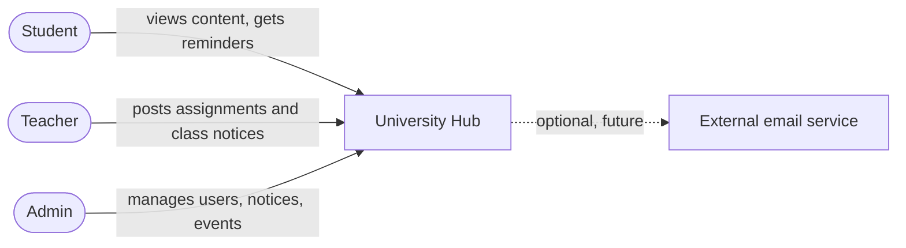
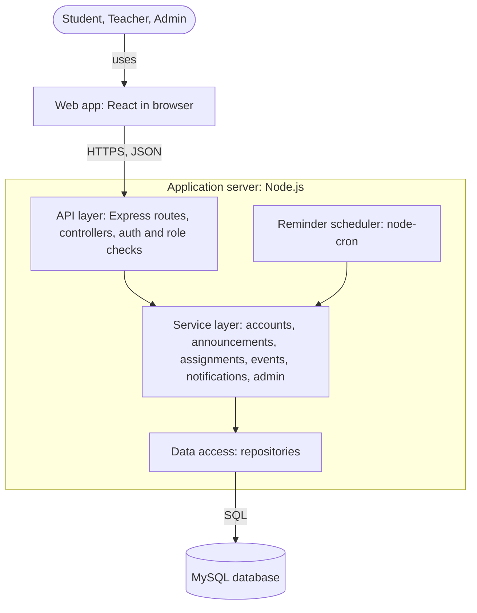
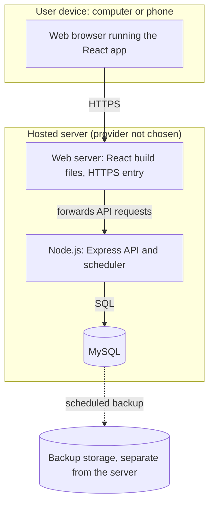

# Task 3: Context, Container and Deployment Diagrams

The deployment sketch matches the context and container diagrams. It shows what runs on which device or server. Hosting is proposed and the provider is not yet chosen.

## Context diagram

## Container diagram

## Deployment diagram

