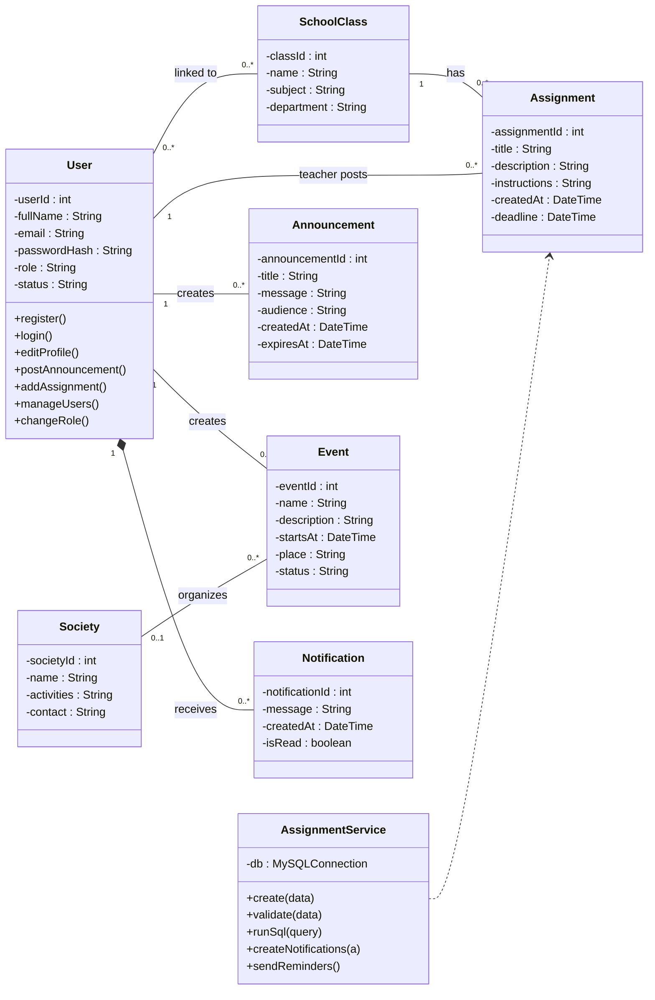
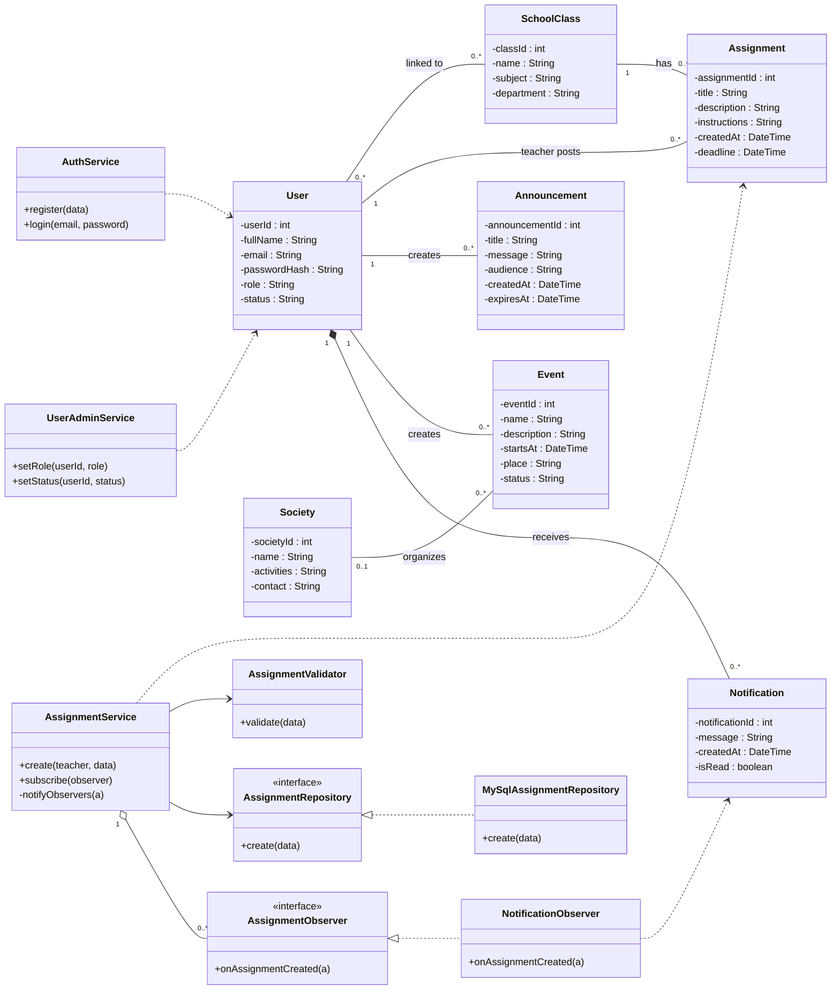

# Task 5: Cohesion and Coupling (and Task 7 class diagram)
Both diagrams use UML class notation: attributes, operations, visibility and multiplicity. Version 1 is the initial design. Version 2 is the improved design. Content services other than assignments are left out to keep the focus.

| Problem class | Problem in version 1 | Fix in version 2 |
|---|---|---|
| User | Low cohesion: account data, login, posting and admin work in one class | User keeps data; AuthService and UserAdminService take login and admin work. Posting belongs to content services. |
| AssignmentService | Does validation, SQL, notifications and reminders; tightly coupled to MySQL | Uses AssignmentValidator, AssignmentRepository and an observer for notifications. Reminders move to the scheduler job. |

## Before (version 1)

## After (version 2, with Observer pattern)

